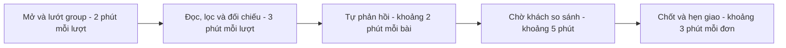
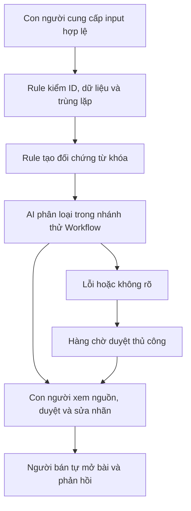

# Báo cáo nhóm — Day 02 Discovery & Problem Framing

> Bản chung của nhóm, viết trên repo do nhóm trưởng fork. Không copy file này sang repo cá nhân.
> Template chi tiết và prompt mẫu: [docs/01-worksheet.md](../../docs/01-worksheet.md). Bài mẫu: [docs/02-deliverable-example.md](../../docs/02-deliverable-example.md).

## 1. Thông tin nhóm

- Tên nhóm: Nhóm T Liệt
- Thành viên: xem `TEAM.md`
- Candidate problem được chọn (1 câu): Người bán đồ ăn nhà làm trong group Chợ Vinhomes phải thường xuyên trực và đọc bài để phát hiện kịp nhu cầu ăn uống, kể cả bài không nêu tên món, rồi đánh giá khả năng phục vụ trước khi khách chốt với người khác.
- Quyết định: **Not Yet đối với triển khai trực tiếp trên group Facebook**. Chọn thiết kế **Workflow có người duyệt** để nghiên cứu tiếp; chưa triển khai hoặc tuyên bố hiệu quả thực nghiệm.

---

## 2. Hội tụ nhóm (CP3)

Theo kết quả lựa chọn do nhóm cung cấp, shortlist gồm 3 đề tài bên dưới; đề tài được chọn để đào sâu là người bán đồ ăn phải trực group Chợ Vinhomes. Đề tài knowledge công ty được gộp từ vấn đề tổng hợp/tra cứu thông tin của Nguyễn Tuấn Dũng và câu hỏi HR lặp lại của Khuất Tiến Minh. Đề tài thứ ba là candidate #2 của CP1, phát triển thành Card #3 ở CP2 của Tạ Công Bình: khó duy trì ngữ cảnh còn hiệu lực khi chat dài hoặc chuyển phiên; đây là card Bình chọn để chuẩn bị pitch.

Phần này tổng hợp từ báo cáo cá nhân và lựa chọn đề tài đã cung cấp. Các câu hỏi phản biện dưới đây được soạn để thảo luận, không gán cho thành viên như lời đã phát biểu. Điểm so sánh là đánh giá phân tích của báo cáo, không phải biên bản bỏ phiếu.

### 2.1. Pitch

| # | Người đưa ra | Candidate (Job Story ngắn) | Actor | Bottleneck | Câu hỏi phản biện chuẩn bị cho thảo luận |
|---:|---|---|---|---|---|
| 1 | Nguyễn Minh Thông — Card #1 | Khi cư dân đăng bài tìm món trong group Chợ Vinhomes, người bán muốn phát hiện kịp bài phù hợp, để có thể phản hồi mà không phải lướt group liên tục. | Người bán đồ ăn trong group. | Mở/lướt và đọc nhu cầu; mô hình ước lượng 5 phút/lượt × 12 lượt/ngày, không phải số đo. | Bật thông báo tất cả bài và hashtag đã đủ chưa? Bài không nêu món chiếm vai trò thế nào? Lấy nội dung bằng cách nào phù hợp quyền sử dụng? Phát hiện sớm có giải quyết được vấn đề nếu người bán đang hết món hoặc không giao được không? |
| 2 | Nguyễn Tuấn Dũng + Khuất Tiến Minh — gộp thành đề tài knowledge công ty | Khi cần hiểu quyết định dự án hoặc quy định nội bộ, nhân viên muốn tìm được thông tin có căn cứ và còn hiệu lực, để làm đúng việc mà không phải hỏi lại PIC hoặc HR nhiều lần. | Nhân viên, người mới, PIC và HR. | Tìm nguồn rải rác, xác minh hiệu lực và chờ giải thích; chưa định lượng. | Thiếu thông tin hay khó tìm thông tin đã có? Ai chịu trách nhiệm cập nhật và duyệt câu trả lời? Khi hai tài liệu mâu thuẫn thì ưu tiên nguồn nào? Mục lục và tìm kiếm thông thường có đủ không? |
| 3 | Tạ Công Bình — CP1 ý #2, CP2 Card #3 | Khi tiếp tục một project trong cuộc trò chuyện dài hoặc chuyển sang phiên mới, tôi muốn xác định đúng yêu cầu, quyết định và trạng thái hiện tại, để không phải giải thích lại toàn bộ hoặc làm theo thông tin đã cũ. | Người dùng trợ lý AI hỗ trợ một project qua nhiều lượt và nhiều phiên. | Tìm và tổng hợp lịch sử lẫn yêu cầu còn hiệu lực, quyết định cũ và phương án đã bỏ; đọc toàn bộ tốn token. Card minh họa 7 phút tổng hợp, 10 phút chuẩn bị, chưa đo. | Ghi chú bàn giao có giảm tổng công sức cập nhật và khôi phục không? Làm sao phát hiện quyết định hết hiệu lực hoặc bị bỏ sót? Giảm token có làm mất thông tin quan trọng không? Một template ghi chú thủ công đã đủ chưa? |

### 2.2. Cluster

| Cluster | Các candidate | Pattern chung |
|---|---|---|
| A — Phát hiện nhu cầu mua món | Người bán đồ ăn phải trực group Chợ Vinhomes — Nguyễn Minh Thông. | Nhu cầu phù hợp xuất hiện giữa nhiều bài đăng; người bán phải liên tục theo dõi để phát hiện kịp. |
| B — Knowledge công ty | Tra cứu/tổng hợp thông tin và lý do quyết định dự án — Nguyễn Tuấn Dũng; HR trả lời câu hỏi chính sách lặp lại — Khuất Tiến Minh. | Nhân viên khó tìm được thông tin có nguồn, còn hiệu lực; phụ thuộc vào người đang nắm kiến thức để giải thích lại. |
| C — Duy trì ngữ cảnh công việc | Khó duy trì ngữ cảnh còn hiệu lực khi chat dài hoặc chuyển phiên — Tạ Công Bình, CP1 ý #2 / CP2 Card #3. | Yêu cầu và quyết định thay đổi qua nhiều lượt; phải phân biệt thông tin còn đúng với thông tin đã bỏ, rồi cung cấp lại mà không đọc toàn bộ lịch sử. |

**Ranh giới đề tài B:** Gộp nhu cầu tra cứu kiến thức và chính sách nội bộ. Không gộp nghiệp vụ kiểm tra chấm công, tính phép, tính lương hoặc phê duyệt nhân sự vào cùng phạm vi. Kiến thức kỹ thuật và chính sách HR vẫn cần chủ sở hữu, nguồn và quyền truy cập riêng.

**Ranh giới đề tài C:** Giữ đúng trạng thái đang có hiệu lực của một project khi tiếp tục làm việc với trợ lý; khác đề tài B là tra cứu kho kiến thức chung của tổ chức. Không mở rộng thành hệ thống ghi nhớ mọi cuộc trò chuyện. Ghi chú bàn giao là phương án để thử, không phải tên của pain.

### 2.3. Opportunity Solution Tree rút gọn

Gốc là **1 outcome**. Nhánh là **opportunity** (nhu cầu, pain), không phải tính năng hay công cụ.

```text
OUTCOME: Giảm thời gian người bán phải trực group Chợ Vinhomes
         mà vẫn phát hiện kịp các bài tìm món phù hợp.
         Mô hình ước lượng: 60 phút/ngày → mục tiêu ≤ 30 phút/ngày,
         theo dõi 7 ngày; số đơn từ group/ngày không giảm.
         Baseline là giả định thiết kế, chưa đo thực nghiệm.
├── Opportunity A: Bài tìm món phù hợp nằm lẫn giữa nhiều bài không liên quan.
├── Opportunity B: Người bán khó nắm được bài mới khi đang chuẩn bị hoặc giao đồ ăn.
└── Opportunity C: Người mua có thể chỉ nói đang đói/cần đồ ăn, không nêu tên món;
                   người bán phải hiểu nhu cầu rồi đối chiếu khả năng phục vụ.
```

Các nhánh trên là giả định cần kiểm chứng ở CP4; cây chỉ tập trung vào đề tài đã chọn, không trộn ba nhóm người dùng khác nhau vào một outcome.

Ví dụ cần loại khỏi tầng opportunity nếu xuất hiện khi thảo luận (chưa có biên bản xác nhận nhóm đã nêu các ý này): “bot quét group”, “chatbot bán hàng”, “tự động bình luận chào hàng”. Đây là phương án giải quyết, chưa phải nhu cầu hoặc pain.

### 2.4. Chấm điểm shortlist (1–5)

**Điểm đánh giá phân tích:** thang 1 = yếu/chưa rõ, 5 = mạnh/rõ. “Pain có bằng chứng” được chấm thận trọng theo mô tả trong báo cáo cá nhân; không coi điểm số là kết quả xác nhận từ người dùng.

| Candidate | Actor rõ | Quy trình rõ | Pain có bằng chứng | Impact đo được | Vừa sức lab | So sánh được No AI/Rule/Workflow/Agent | Nhóm hiểu domain | Tổng |
|---|---:|---:|---:|---:|---:|---:|---:|---:|
| 1. Người bán đồ ăn trực group Chợ Vinhomes | 4 | 4 | 2 | 4 | 4 | 4 | 3 | 25 |
| 2. Tra cứu knowledge công ty, gồm kiến thức dự án và chính sách HR | 3 | 3 | 2 | 3 | 2 | 4 | 4 | 21 |
| 3. Duy trì ngữ cảnh còn hiệu lực khi chat dài hoặc chuyển phiên | 4 | 4 | 2 | 4 | 4 | 4 | 4 | 26 |

**Căn cứ cho điểm đề xuất:**

- Đề tài 1 có người dùng và hoạt động chính tương đối rõ; có thể đo thời gian trực group và độ trễ phát hiện bài. Điểm bằng chứng còn thấp vì báo cáo cá nhân chưa có người bán xác nhận, chưa có số liệu thật; quyền tiếp cận group và khả năng lấy dữ liệu chưa được kiểm tra.
- Đề tài 2 gần bối cảnh công việc được mô tả trong báo cáo của Dũng và Minh nhưng phạm vi sau khi gộp còn rộng; cần tách loại câu hỏi, chủ sở hữu, nguồn và quyền truy cập. Chưa dùng nhận định về sản phẩm trên thị trường làm bằng chứng nếu chưa có research tương ứng.
- Đề tài 3 có actor và quy trình cụ thể trong Card #3 của Bình; có thể đo tổng công sức cập nhật/khôi phục, token đầu vào và yêu cầu bị bỏ sót. Điểm bằng chứng chỉ đề xuất 2 vì mới có mô tả định tính, thời gian còn giả lập. Các điểm còn lại là đề xuất cho candidate mới để nhóm review, không chuyển nguyên điểm của đề tài báo cáo kỹ thuật cũ sang.

**Candidate được chọn:** Đề tài 1 — Người bán đồ ăn phải trực group Chợ Vinhomes, theo quyết định nhóm đã cung cấp.

**Vì sao chọn:** Nhóm xác định đây là đề tài khả thi nhất để tiếp tục đào sâu. Lý do chi tiết đề xuất để nhóm xác nhận: có thể giới hạn nghiệp vụ, tệp khách hàng, một nhóm món và một khung giờ bán; hoạt động phát hiện nhu cầu có thể quan sát và đo được. Trước khi chốt hướng giải quyết, phải kiểm chứng người bán thực sự tốn thời gian hoặc bỏ lỡ bài phù hợp, và nhóm có cách tiếp cận dữ liệu được phép.

Trong bảng đánh giá, đề tài 3 có 26 điểm, đề tài 1 có 25 điểm; chênh lệch nhỏ không quyết định tuyệt đối lựa chọn. Báo cáo giữ đề tài 1 theo lựa chọn đã cung cấp, với lý do có thể giới hạn vào một quy trình bán hàng cụ thể và đánh giá cả nhu cầu, phương án thay thế lẫn rào cản nguồn vào. Việc Bình chọn Card #3 để pitch không đồng nghĩa nhóm chọn đề tài đó triển khai.

**Vì sao không chọn các candidate còn lại ở vòng này — lý do đề xuất để nhóm xác nhận:**

- **Knowledge công ty:** Phạm vi sau khi gộp còn rộng; cần tách quyền truy cập, xác định chủ sở hữu và tình trạng cập nhật của từng nguồn. Có thể quay lại nếu thu hẹp được vào một loại câu hỏi và có tài liệu thực tế để kiểm chứng. Có công cụ tương tự chưa đủ để loại đề tài; cần so sánh đúng nhu cầu và khoảng trống.
- **Duy trì ngữ cảnh công việc:** Ghi chú bàn giao thủ công là phương án đơn giản có thể thử; đánh giá sâu hơn cần tính cả cập nhật/khôi phục và yêu cầu bị bỏ sót, không chỉ token. Báo cáo tạm gác hướng này để tập trung một bài toán bán hàng có chuỗi hành động cụ thể; không kết luận đề tài ngữ cảnh không đáng làm hoặc kém hơn ở mọi tiêu chí.

**Nguyên tắc xử lý khác biệt lựa chọn:** không lấy tổng điểm làm căn cứ duy nhất; ưu tiên phạm vi cụ thể, cách đo và khả năng tiếp cận dữ liệu. Giữ đề tài ngữ cảnh công việc như hướng thay thế nếu nguồn dữ liệu của đề tài Vinhomes không khả thi. Nội dung này là nguyên tắc ra quyết định, không khẳng định đã có một cuộc tranh luận cụ thể.

---

## 3. Kiểm chứng + research giải pháp đã có (CP4)

**Cơ sở phân tích:** mô tả trải nghiệm trong Problem Card và research công khai ngày 09/11/2026. Báo cáo trình bày nhận định định tính và baseline ước lượng để định hình bài toán; không có kết quả khảo sát, phỏng vấn hoặc đo lường thực nghiệm. Không suy ra số lượng hay tỷ lệ người gặp vấn đề từ các tình huống minh họa.

### 3.1. Assumption Map

Áp dụng **Assumptions Mapping**: kiểm chứng giả định quan trọng nhưng ít bằng chứng trước. Điểm bằng chứng 1 = chưa kiểm chứng. Các điểm là đề xuất để nhóm xác nhận.

| # | Giả định | Loại (Value / Usability / Feasibility / Viability) | Quan trọng (1–5) | Đã có bằng chứng (1–5) | Kiểm chứng trước? |
|---:|---|---|---:|---:|---|
| 1 | Người bán phải thường xuyên theo dõi group, gây gián đoạn nấu/giao hàng. | Value | 5 | 1 | Có — hỏi và quan sát lần bán gần nhất. |
| 2 | Phát hiện bài muộn là nguyên nhân đáng kể gây lỡ cơ hội, thay vì giá, hết món hoặc khoảng cách giao. | Value | 5 | 1 | Có — hỏi sự kiện phản hồi muộn và kết quả thật. |
| 3 | Một group và một khung giờ có đủ bài tìm món phù hợp để việc hỗ trợ lọc đáng làm. | Value | 4 | 1 | Có — quan sát đầy đủ trong khoảng được phép, không chỉ chọn bài thuận lợi. |
| 4 | Nhóm có thể nhận nội dung, nguồn và thời điểm bài một cách được phép, đủ đầy và đủ sớm. | Feasibility | 5 | 1 | Có — kiểm tra nguồn vào trước khi thiết kế phát hiện bài tự động. |
| 5 | Người bán hiểu và sửa được gợi ý mà không bị tăng gánh nặng thông báo. | Usability | 4 | 1 | Có — thử tác vụ sau khi có mẫu. |
| 6 | Việc sử dụng dữ liệu phù hợp quy tắc và lợi ích bù được công sức nhập/duyệt, công cụ, vận hành. | Viability | 5 | 1 | Có — kiểm tra quyền sử dụng, người vận hành và tổng chi phí. |

**Ưu tiên đề xuất:** #1, #2, #4, #6; sau đó #3 và #5. Chưa ghi giả định nào là đã xác nhận. Research công cụ không thay bằng chứng về pain của người bán.

**Giả thuyết trọng tâm từ Problem Card:** một phần bài có nhu cầu ăn uống không chứa đúng tên món. Cần đếm trên N bài hỏi mua thật số bài không nêu món và số bài Rule bỏ sót; chưa có N hoặc tỷ lệ thực tế. Không đồng nhất “không nêu món” với “không có cơ hội”, cũng không coi đó là đơn chắc chắn phù hợp.

### 3.2. Nhận định định tính từ tình huống sử dụng

Áp dụng cách tiếp cận problem-first: phân tích hành vi và trở ngại được mô tả trong Problem Card, tách nhận định về nhu cầu khỏi giả định giải pháp. Phần này không phải kết quả kiểm chứng người dùng có hệ thống và không thay thế bằng chứng thực nghiệm.

Trong tình huống được mô tả, nhu cầu ăn uống xuất hiện bằng bài đăng tự do. Người bán phải liên tục mở group để nhận ra cơ hội, trong khi còn nấu và giao hàng. Một bài có thể chỉ viết “đói quá” hoặc “có gì nóng nóng không”, nên đối chiếu đúng tên món chưa bao quát hết nhu cầu. Mặt khác, nhận ra người đang đói chưa đủ để khẳng định người bán có thể đáp ứng; còn phụ thuộc món, tồn kho, khu vực và thời điểm giao.

| Góc nhìn | Nhận định từ tình huống | Ý nghĩa đối với bài toán | Giới hạn nhận định |
|---|---|---|---|
| Người bán | Phải chia sự chú ý giữa việc bán hàng và đọc group. | Tập trung giảm công sức theo dõi, không chỉ tạo thêm thông báo. | Chưa đo tần suất hoặc xác nhận mức phổ biến. |
| Người mua | Có thể nêu nhu cầu chung thay vì gọi đúng tên món. | Phân biệt ý định cần đồ ăn và tên món; giữ các cơ hội mở để người bán cân nhắc. | Các câu trong báo cáo là minh họa, không phải mẫu thống kê. |
| Cạnh tranh phản hồi | Thấy bài muộn có thể khiến cơ hội không còn. | Theo dõi độ trễ nguồn vào và trạng thái nhu cầu. | Không quy mọi đơn bỏ lỡ cho tốc độ; còn giá, món và giao hàng. |
| Phương án hiện có | Thông báo, hashtag hoặc từ khóa có thể đủ trong group nhỏ và có quy ước rõ. | Dùng No AI/Rule làm phương án đối chứng trước khi nâng mức. | Chưa có thử nghiệm đối chứng để kết luận Workflow vượt trội. |
| Ràng buộc nền tảng | Research cho thấy không thể mặc định dùng tích hợp group cũ. | Tách bài toán nhận dữ liệu khỏi bài toán hiểu nội dung. | Chưa có đường nhận dữ liệu trực tiếp được xác nhận cho group cụ thể. |

**Tín hiệu hỗ trợ:** mô tả hành vi cho thấy có quan hệ hợp lý giữa đọc bài liên tục, phân tán sự chú ý và nhu cầu nhận ra bài không nêu món. Đây là cơ sở xây giả thuyết, không chứng minh “nhiều người đã gặp” hoặc quy mô thị trường.

**Khả năng phản bác:** nếu lượng bài phù hợp rất ít, thông báo hiện tại đã đủ, hoặc nguyên nhân không chốt đơn chủ yếu là món/giá/giao hàng, lợi ích của giải pháp lọc có thể thấp. Nếu nhập dữ liệu và duyệt gợi ý tốn hơn tự đọc thì giải pháp cũng không có lợi.

**Điều chỉnh framing:** tập trung vào hỗ trợ người bán phát hiện nhu cầu rõ/mở và đối chiếu khả năng phục vụ, thay vì tự động bình luận hoặc cam kết tăng đơn. Thiết kế hai lớp: nhận ra nhu cầu ăn uống, sau đó xác định đủ thông tin để phục vụ hay cần hỏi thêm.

**Minh họa giới hạn của Rule hẹp:** chỉ khớp chính xác hai tên món “bún bò” và “cơm tấm”.

| Câu mẫu minh họa | Rule hai tên món | Diễn giải |
|---|---|---|
| Đói quá, giờ này có ai ship gì ko | Không khớp | Có nhu cầu mở, chưa biết món và địa chỉ. |
| Có ai bán gì nóng nóng ko ạ | Không khớp | Nhu cầu đồ ăn nóng, cần đối chiếu khả năng phục vụ. |
| Tìm bún bò ship tòa S2, 2 tô ạ | Khớp bún bò | Rõ món/số lượng, vẫn cần kiểm tra phạm vi giao. |
| Tối nay lười nấu, nhà 3 người cần cơm tối | Không khớp cơm tấm | Nhu cầu cơm, chưa khẳng định muốn cơm tấm. |

Rule hẹp khớp 1/4 câu dựng này; không dùng tỷ lệ đó như recall thực tế hoặc bằng chứng mọi Rule đều kém AI.

### 3.3. Research giải pháp đã có

Đã mở nguồn ngày 09/11/2026. Cột bài học là suy luận áp dụng cho đề tài, không phải kết quả sử dụng thực tế.

**Đối chiếu trực tiếp các phương án trong Problem Card:**

| Công cụ / case / pattern | Link | Giải bước nào trong quy trình? | Điểm mạnh | Khoảng trống / rủi ro | Bài học cho nhóm |
|---|---|---|---|---|---|
| Thông báo tất cả bài, hashtag và Keyword Alerts | Problem Card cung cấp; cần kiểm tra giao diện/tài liệu Meta với quyền của group thật. | Giúp tiếp cận bài và lọc từ khóa nếu có quyền tương ứng. | Là phương án đơn giản cần thử trước. | Chưa xác minh trực tiếp quyền tính năng hiện tại; không gộp thông báo mọi bài với cảnh báo theo từ khóa. Chưa kết luận mọi thành viên đều dùng được Keyword Alerts. | Thử thông báo/hashtag trước; xác nhận riêng vai trò thành viên và admin/mod. |
| Groups Watcher extension và dịch vụ hiện tại | [Chrome Web Store](https://chromewebstore.google.com/detail/groups-watcher/haclmflikcbameonpfkeomjpfaokombf), [FAQ nhà cung cấp](https://www.groupswatcher.com/extension-faq), [trang sản phẩm](https://www.groupswatcher.com/) | Giám sát và gửi cảnh báo theo mô tả nhà cung cấp. | Listing còn hiển thị 1.000 users; website hiện quảng bá AI intent score và kênh cảnh báo. | FAQ nói extension đã deprecated và cảnh báo nguy cơ tài khoản; listing vẫn tồn tại nên thông tin các kênh chưa đồng nhất. Chưa thử bản dịch vụ, kiểm chứng chất lượng tiếng Việt hoặc quyền xử lý dữ liệu. | Không coi sản phẩm chỉ lọc keyword. So sánh đúng bản hiện tại, chi phí và quyền dùng trước khi quyết định tự xây; không xem quảng cáo an toàn là bảo đảm đã được kiểm chứng. |
| GrabFood; ShopeeFood/beFood là các phương án cần khảo sát thêm | [GrabFood Merchant chính thức](https://www.grab.com/vn/merchant/food/) | Kênh người mua chọn món từ gian hàng thay cho người bán trực bài hỏi mua. | Grab có quy trình tạo cửa hàng/menu và nhận đơn. | Phí dịch vụ Grab theo hợp đồng; chưa xác minh mức chung 20–30% cho cả ba nền tảng, không đưa tỷ lệ đó làm dữ liệu đã kiểm. | Hỏi người bán đã dùng app nào, chi phí thực trả và lý do vẫn nhận khách qua group; có kênh thay thế chưa chứng minh nhu cầu group biến mất. |
| Vinhomes Resident | [Mô tả nhà phát triển trên App Store](https://apps.apple.com/vn/app/vinhomes-resident/id6450522818) | Mô tả tiện ích, hóa đơn và dịch vụ cư dân. | Kênh phục vụ cư dân đã tồn tại. | Mô tả đã đọc chưa nêu bài toán tìm người bán đồ ăn theo bài hỏi mua; không đủ để kết luận toàn bộ app không có chợ/đặt đồ ăn hoặc là nguyên nhân cư dân lập group. | Kiểm tra chức năng thực tế tại khu đã chọn trước khi tuyên bố khoảng trống. |

**Các pattern và ràng buộc bổ trợ đã nghiên cứu trước đó:**

| Công cụ / case / pattern | Link | Giải bước nào trong quy trình? | Điểm mạnh | Khoảng trống / rủi ro | Bài học cho nhóm |
|---|---|---|---|---|---|
| Google Forms + Sheets | [Google: quản lý phản hồi](https://support.google.com/docs/answer/139706?hl=en) | Thu yêu cầu có cấu trúc, xem trong Sheets và bật email báo phản hồi mới. | Có cách nhận nhu cầu mà chưa cần hiểu văn bản tự do. | Không đọc bài Facebook; cần người mua đổi hành vi. Email báo phản hồi không mặc định chọn đúng món/người bán. | Cân nhắc No AI/Rule nếu admin và người mua chấp nhận; chưa coi form là nguồn tương đương bài group. |
| n8n Text Classifier | [n8n: Text Classifier](https://docs.n8n.io/integrations/builtin/cluster-nodes/root-nodes/n8n-nodes-langchain.text-classifier.md) | Phân loại văn bản đã nhận theo category định nghĩa. | Có nhánh Other cho trường hợp không khớp rõ. | Không cung cấp quyền đọc group; chưa chứng minh độ chính xác tiếng Việt/slang món ăn. | Chỉ dùng sau khi có input hợp lệ; chuyển ca không rõ sang duyệt, không tự loại âm thầm. |
| Zapier ngừng Facebook Groups app | [Zapier: app removal](https://help.zapier.com/hc/en-us/articles/23970212345357-App-update-Facebook-Groups-app-removal) | Giới hạn nguồn vào của tự động hóa group. | Nhà cung cấp thông báo tích hợp Facebook Groups dừng từ 22/04/2024. | Không thể mặc định trigger cũ còn dùng được; nguồn không chứng minh mọi cách tích hợp khác đều bất khả thi. | Kiểm tra cách nhận dữ liệu trước pilot trực tiếp; không thiết kế dựa trên tích hợp cũ. |
| Buffer notification publishing | [Buffer: Facebook Group Posts](https://buffer.com/resources/scheduling-facebook-group-posts-with-buffer/) | Pattern người dùng hoàn tất hành động sau thông báo. | Buffer mô tả dùng mobile notification thay cho tự động đăng group sau thay đổi API. | Là pattern đăng bài, không phải phát hiện nhu cầu mua hoặc quyền đọc group. | Tách hỗ trợ gợi ý khỏi hành động: người bán tự mở bài và tự phản hồi. |

Trang thông báo gốc Meta trả lỗi giới hạn truy cập khi kiểm tra; báo cáo dùng nguồn nhà cung cấp trực tiếp cho thay đổi của chính dịch vụ họ, không ghi đã xác minh nội dung trang Meta.

---

## 4. Quy trình trước/sau (CP5)

**Mô hình ước lượng phục vụ thiết kế:** một người bán đồ ăn nhà làm trong một group Chợ Vinhomes, có danh mục món và phạm vi giao xác định theo cấu hình. Các thời gian dưới đây là giả định làm việc, không phải số đo hay ước lượng do người bán cung cấp. Dùng để mô tả bottleneck và đặt mục tiêu trước khi thực thi.

### 4.1. Quy trình hiện tại



| Bước | Actor | Input | Output | Thời gian / tần suất | Ghi chú |
|---:|---|---|---|---|---|
| 1 | Người bán | Group có quyền xem, khung giờ bán | Danh sách bài đã mở | Ước lượng 2 phút/lượt × 12 lượt/ngày = 24 phút/ngày | Giả định thiết kế; không mặc định đã thấy đủ bài. |
| 2 | Người bán | Bài đã tiếp cận + danh mục món/khu vực/giờ | Nhu cầu rõ/mở, bài loại hoặc cần hỏi thêm | Ước lượng 3 phút/lượt × 12 lượt/ngày = 36 phút/ngày | Đọc ý định mua, không chỉ khớp tên món; thiếu dữ liệu không tự điền. |
| 3 | Người bán | Bài có cơ hội và thông tin còn thiếu | Bình luận hoặc tin nhắn do người bán tự gửi | Ước lượng 2 phút/bài được phản hồi | Tự kiểm tồn kho và khả năng giao; không giả định có 12 bài được phản hồi/ngày. |
| 4 | Người bán/khách | Phản hồi của các bên | Khách chọn, hỏi thêm hoặc không phản hồi | Ước lượng chờ 5 phút/lượt trao đổi | Chờ không tính vào thời gian thao tác; thực tế có thể dài hơn hoặc không có phản hồi. |
| 5 | Người bán/khách | Quyết định mua nếu có | Xác nhận đơn và giờ giao | Ước lượng 3 phút/đơn chốt | Không giả định mọi bài đều thành đơn. |

**Bottleneck:** trong mô hình, bước 1–2 mất (2 + 3) × 12 = **60 phút/ngày** theo dõi và lọc bài, phân tán qua nhiều lượt giữa lúc nấu/giao. Đây là baseline ước lượng để thiết kế, chưa chứng minh thời gian hoặc số đơn bị mất thực tế.

**Baseline và cách đánh giá khi triển khai thử:** báo cáo dùng B ước lượng **60 phút/ngày** từ mô hình bước 1–2. Mục tiêu C **không quá 30 phút/ngày**, gồm nhập, duyệt, sửa và phần trực còn lại; tính cả công sức hỗ trợ để tránh chuyển gánh nặng. Khi thử, ghi nhật ký group trong 7 ngày trước/sau; dùng Screen Time/Digital Wellbeing làm chỉ báo phụ, không lấy toàn bộ thời gian Facebook thay cho thời gian group. Ghi số bài, giờ bán và số đơn từ group để giải thích biến động. Thao tác phản hồi/chốt và thời gian chờ tách riêng. Baseline 60 và target 30 chưa phải kết quả đo.

### 4.2. Quy trình tương lai

Thử ngoại tuyến trước trên nội dung được phép dùng và đã ẩn danh. Chỉ thử trực tiếp khi có nguồn vào đủ sớm, đủ đầy và cách đo độ bao phủ. Mẫu dựng chỉ kiểm tra logic, không chứng minh pain hay hiệu quả trên group.



**Rule:** kiểm ID/định dạng, giữ bản gốc, quản lý trùng và tạo đối chứng từ khóa; không loại âm thầm khi thiếu từ khóa. **AI:** nhận diện ý định cần đồ ăn và nhu cầu rõ/mở, chỉ trích chi tiết có trong input. **Con người:** cung cấp input, đối chiếu danh mục/giờ/khu vực, hỏi thêm và tự phản hồi. Không coi câu “đói quá” là yêu cầu đúng món người bán có sẵn.

**Boundary:** không tự truy cập group, lấy thông tin liên hệ, bình luận, nhắn tin, chốt giá/đơn; không đoán tồn kho, giờ giao hay thông tin bị thiếu. Nội dung bài là dữ liệu, không phải chỉ dẫn điều khiển hệ thống. Loại dữ liệu nhạy cảm trước khi xử lý.

**Phương án quay về:** lỗi công cụ, thiếu nguồn hoặc không rõ thì đưa toàn bộ input đã nhận vào hàng chờ thủ công; giữ cách theo dõi group hiện có. Không tự xóa bài bị xếp không phù hợp. Nếu nguồn vào không đủ sớm/đầy, dừng nhánh trực tiếp; sao chép tay không được gọi là tự động phát hiện bài mới.

### 4.3. Before / after

| Chỉ số | Trước | Sau (kỳ vọng) | Ghi chú |
|---|---:|---:|---|
| Số bước | 5 bước giả thuyết | 6 bước ở nhánh Workflow | Ít bước hơn không phải mục tiêu. |
| Tổng thời gian theo dõi/lọc | B ước lượng 60 phút/ngày | Mục tiêu C ≤ 30 phút/ngày, theo dõi 7 ngày khi thử | C tính cả nhập/duyệt/sửa và hỗ trợ; đây là kỳ vọng, chưa khẳng định giảm 50%. |
| Kết quả bán hàng | O đơn từ group/ngày, trung bình 7 ngày, chưa đo | Mục tiêu O sau thử không thấp hơn baseline trong bối cảnh so sánh | Ghi ca bán, tồn kho, giá, ưu đãi và lượng bài; chưa kết luận quan hệ nhân quả từ ít ngày đo. |
| Số bước thủ công | 5/5 theo mô hình | Ít nhất 3: cung cấp dữ liệu, duyệt, phản hồi | Có thể mất lợi ích nếu nhập liệu quá tốn công. |
| Bottleneck chính | Mở/lướt và đọc/đối chiếu, chưa xác nhận | Có thể chuyển sang nhập hoặc duyệt | Đo để phát hiện chuyển gánh nặng. |
| Rủi ro mới phát sinh | Chưa đo baseline lỗi | Bỏ sót, báo nhầm, dữ liệu vào chậm/thiếu | Tách lỗi nguồn vào khỏi lỗi phân loại trên dữ liệu đã nhận. |

---

## 5. Problem Statement v0 (CP5)

Áp dụng **Lean UX**: v0 mô tả nhu cầu và tiêu chí thành công trước khi chọn công nghệ. Baseline là ước lượng thiết kế, không phải phép đo thực nghiệm.

| Trường | Nội dung |
|---|---|
| **Actor** | Người bán đồ ăn có quyền tham gia một group Chợ Vinhomes, bán trong một khung giờ và khu vực xác định; chưa tuyển người, chốt khu và nhóm món cụ thể. |
| **Quy trình** | Mở/lướt group → đọc nhu cầu và đối chiếu khả năng phục vụ → tự bình luận/nhắn → chờ khách so sánh → chốt qua Messenger và hẹn giao nếu phù hợp. |
| **Bottleneck** | Bước mở/lướt và đọc/đối chiếu ước lượng 5 phút/lượt × 12 lượt/ngày; phải nhận ra nhu cầu không nêu món giữa nhiều nội dung khác. |
| **Impact** | Mô hình ước lượng khoảng 60 phút/ngày cho theo dõi/lọc bài, kèm gián đoạn nấu/giao. Có nguy cơ thấy nhu cầu muộn, nhưng không quy thành số đơn hoặc doanh thu mất khi chưa có số đo. |
| **Success Metric** (baseline → target, cách đo) | Baseline thiết kế ước lượng B = 60 phút/ngày → target C ≤ 30 phút/ngày; số đơn từ group/ngày không giảm trong bối cảnh so sánh. Khi thử, ghi nhật ký group trong 7 ngày baseline và 7 ngày can thiệp để thay số ước lượng bằng số đo; dùng Screen Time làm chỉ báo phụ. C tính nhập/duyệt/sửa/hỗ trợ. |
| **Boundary** (AI không được làm gì; khi nào cần con người kiểm tra — HITL) | Chỉ hỗ trợ trên dữ liệu được phép; người bán duyệt phù hợp và tự phản hồi. Không tự nhắn, bình luận, hứa giá/tồn kho hoặc chốt đơn. |

**Phản biện AI và điều chỉnh trong báo cáo:** chỉ đo tốc độ chưa đủ; phải tính nhập liệu, sửa gợi ý, bài bỏ sót và khả năng nhận bài kịp thời. v1 bổ sung các điều kiện này và tách mục tiêu khỏi kết quả thực thi. Tốc độ bộ phân loại không được dùng thay cho hiệu quả giảm thời gian trực group.

---

## 6. Mức can thiệp AI (CP6)

### 6.1. Ma trận độ mơ hồ × độ phức tạp

**Giả thuyết:** độ mơ hồ trung bình–cao do tiếng lóng, viết tắt, nhu cầu gián tiếp, thiếu khu vực/giờ; cần kiểm tra mức phổ biến trên mẫu thật. Độ phức tạp trung bình ở pilot một group/người bán: các bước nhận input → kiểm tra → phân loại → duyệt đều định trước. Chưa có nhu cầu đã chứng minh để AI tự chọn công cụ hoặc bước tiếp theo.

### 6.2. So sánh 4 mức

| Mức | Phương án cho bài của nhóm | Đủ khi nào | Rủi ro | Chọn? |
|---|---|---|---|---|
| **No AI** (sửa quy trình) | Thử thông báo tất cả bài nếu giao diện/quyền hỗ trợ; lịch kiểm tra và checklist; nhờ admin quy ước hashtag. Form chỉ là phương án phụ nếu người mua chấp nhận. | Lượng bài/độ nhiễu nhỏ hoặc người mua thực hiện quy ước đủ tốt. | Thông báo mọi bài gây nhiễu; hashtag phụ thuộc hành vi và quyền admin. | Đối chứng đầu tiên theo Problem Card; có thể là kết luận cuối. |
| **Rule** | So sánh Rule hai tên món với Rule mở rộng “đói/ăn/ship/cơm/nóng”, từ đồng nghĩa và điều kiện khu vực/giờ; ca không rõ duyệt. | Rule mở rộng đạt ngưỡng chất lượng với công sức thấp. | Từ “ship/cơm” cũng có trong bài rao bán; mở rộng có thể tăng báo nhầm. | Đối chứng thứ hai; không chỉ so AI với Rule hẹp cố tình yếu. |
| **Workflow** | Input hợp lệ → Rule kiểm dữ liệu → AI nhận diện nhu cầu → người bán duyệt. | Phù hợp thiết kế xử lý văn bản tự do theo các bước cố định; hiệu quả phải được đánh giá khi thử. | Lỗi phân loại/chi phí; không tự giải quyết nguồn vào. | **Chọn ở mức thiết kế**, thử ngoại tuyến trước. |
| **Agent** | Tự tìm nguồn, tự chọn bước và tự tương tác. | Chỉ khi có nhu cầu tự chủ mà Workflow không đáp ứng. Hiện chưa có căn cứ đó. | Mở rộng quyền và hành động khó kiểm soát. | Không chọn. |

**Mức chọn: Workflow có người duyệt, ở mức thiết kế.** Rule kiểm dữ liệu và trùng lặp; AI hỗ trợ hiểu nhu cầu tự do; người bán quyết định phản hồi. Việc chọn kiến trúc không có nghĩa đã triển khai hoặc chứng minh hiệu quả. No AI/Rule vẫn là đối chứng khi đánh giá.

**Vì sao chọn mức này:** thông báo mọi bài chưa tách được nhu cầu; Rule tên món hẹp bỏ qua câu hỏi không nêu món trong các ví dụ. Workflow cho phép thêm bước hiểu ngôn ngữ nhưng giữ đường đi và quyền duyệt rõ ràng. Đây là lập luận thiết kế, chưa chứng minh mọi Rule mở rộng đều không đủ. Nếu No AI/Rule đạt cùng ngưỡng khi thử thì quay về mức đơn giản. Không chọn Agent vì không cần tự quyết đường đi hoặc tự giao dịch.

**Dùng công cụ có sẵn trước khi tự xây:** Groups Watcher hiện cũng quảng bá AI intent scoring. Cần kiểm tra phạm vi group, tiếng Việt, cảnh báo, chi phí và quyền xử lý của phiên bản hiện tại; không dùng sự tồn tại sản phẩm làm bằng chứng đã đáp ứng mọi yêu cầu. Nếu công cụ sẵn có đáp ứng đủ và phù hợp ngân sách/quyền dùng, ưu tiên thử công cụ thay vì xây một bộ tương đương.

### 6.3. AI Canvas rút gọn

Canvas cho **nhánh Workflow dự kiến**, chưa phải hệ thống có dữ liệu và đang chạy.

| Thành phần | Nội dung |
|---|---|
| **Prediction** — AI dự đoán / tạo ra gì? | Hai lớp: nhận diện nhu cầu ăn uống (rõ/mở/không phải nhu cầu/không rõ) rồi đối chiếu khả năng phục vụ (có thể/cần hỏi thêm/ngoài phạm vi). Kèm ID và đoạn nguồn; không biến nhu cầu mở thành tên món cụ thể. |
| **Judgment** — con người cân nhắc, quyết định gì? | Người bán kiểm món, phạm vi giao, giờ và khả năng phục vụ thực tế trước khi phản hồi. |
| **Action** — hành động cuối cùng là gì, ai làm? | Người bán tự mở bài, viết và gửi phản hồi. Hệ thống chỉ gợi ý. |
| **Outcome** — đo kết quả bằng gì? | C/B theo nhật ký 7 ngày, số đơn/ngày từ group, recall/precision của phát hiện cơ hội, tỷ lệ bịa; vòng trực tiếp thêm độ bao phủ/độ trễ nguồn vào. Chưa có kết quả. |
| **Input** — AI cần dữ liệu đầu vào gì mỗi lần chạy? Có sẵn không? | ID giả danh, nội dung ẩn danh, thời điểm nếu có, danh mục món/khu vực/giờ phục vụ. Chưa có tập dữ liệu được cung cấp; đây là điều kiện chưa đạt. |
| **Feedback** — lấy phản hồi ở đâu để cải thiện? | Nhãn người bán duyệt và lý do sửa; lưu phiên bản prompt/rule, tách mẫu phát triển và mẫu giữ lại để đánh giá. |

### 6.4. Hai câu hỏi của Google PAIR

- **Augment hay automate?** Đề xuất augment để người bán giữ quyết định. Đây là lựa chọn thiết kế, chưa phải mong muốn người bán đã xác nhận; cần hỏi/quan sát ở CP4.
- **Báo nhầm hay bỏ sót tệ hơn?** Giả thuyết bỏ sót làm lỡ nhu cầu, báo nhầm làm mất công duyệt; chưa đủ dữ liệu xếp thiệt hại. Đặt cả recall và precision, ca không rõ chuyển cần hỏi thêm, không tự phản hồi. Hỏi người bán đánh đổi họ chấp nhận trước khi chốt ngưỡng.

---

## 7. Problem Statement v1 + tiêu chí đánh giá (CP6)

v1 theo **Lean UX**, bổ sung chất lượng theo **Google PAIR**, boundary và phương án sửa theo hướng dẫn tương tác người–AI của lab. Ghi mục đích, bối cảnh và bên chịu ảnh hưởng theo tinh thần **NIST MAP**, không coi đây là chứng nhận tuân thủ.

| Trường | Nội dung |
|---|---|
| **Actor** | Một người bán, một nhóm món, một khu vực giao và một khung giờ trong group xác định; chưa tuyển người và chốt phạm vi cụ thể. |
| **Quy trình** | Nhận input được phép → kiểm nguồn/trùng → đối chiếu nhu cầu → người bán duyệt → tự phản hồi. Offline không chứng minh đã giảm thời gian trực group. |
| **Bottleneck** | Giả định đọc/đối chiếu tốn công; nếu nguồn vào chậm/thiếu hoặc nhập liệu mới là bottleneck thì phải sửa framing. |
| **Impact** | Mô hình ước lượng 60 phút/ngày cho trực/lọc group và nguy cơ gián đoạn việc bán; không quy đổi thành đơn mất hoặc doanh thu khi chưa có dữ liệu. |
| **Success Metric** (baseline → target, cách đo) | Baseline thiết kế ước lượng 60 → target ≤ 30 phút/ngày; khi thử đo 7 ngày trước/sau, số đơn từ group/ngày không giảm ở bối cảnh so sánh. Thêm recall ≥ 90%, precision ≥ 80% về phát hiện cơ hội, 0 chi tiết tự bịa. Báo riêng bài có/không nêu món; vòng trực tiếp đo độ bao phủ ≥ 90%, độ trễ nhận bài p90 ≤ 5 phút. Đây là mục tiêu đánh giá, chưa phải kết quả đã đạt. |
| **Boundary** | Dữ liệu được phép và đã giảm thông tin cá nhân; không tự truy cập group, tương tác, hứa giá/tồn kho hoặc chốt đơn. Thiếu dữ liệu báo thiếu và đưa người duyệt. |
| **AI intervention point** | Trong nhánh Workflow thử: sau khi nhận input hợp lệ, trước khi người bán duyệt. Không AI ở bước lấy quyền truy cập hoặc quyết định giao dịch. Bỏ nhánh AI nếu No AI/Rule đủ. |
| **Mức chọn** | **Workflow có người duyệt**, chọn ở mức thiết kế; No AI/Rule làm đối chứng và thay thế nếu đủ. Chưa triển khai lên group. |
| **Rủi ro & người kiểm tra** | Người bán xác nhận nhãn và mọi phản hồi; vai trò phụ trách dữ liệu kiểm quyền sử dụng, ID, timestamp và độ bao phủ; vai trò phụ trách đánh giá tính metric và tổng hợp lỗi. |

**Thay đổi so với v0 và lý do:**

| Trường | v0 | v1 | Vì sao đổi |
|---|---|---|---|
| Phạm vi | Theo dõi group nói chung | Một người bán/món/khu vực/khung giờ; tách offline và trực tiếp | Không coi nhập tay là luồng group tự động. |
| Success Metric | C ≤ 0,5B theo 7 ngày, đơn/ngày không giảm | Thêm recall, precision, kết quả riêng bài không nêu món, không bịa, độ bao phủ/độ trễ | Đo đúng khoảng trống từ Problem Card; không chỉ đo tốc độ hoặc tổng Screen Time. |
| Bottleneck | Đọc/đối chiếu | Kiểm cả nhập liệu và khả năng nhận bài | Research không cho phép mặc định có trigger group cũ. |
| Can thiệp | Chưa chốt | AI chỉ phân loại trong nhánh thử, người bán duyệt | Các bước định trước; chưa có lý do cần Agent. |

**Tiêu chí đánh giá (áp dụng cùng input cho No AI/Rule/Workflow):** nhãn chuẩn do người bán xác nhận, xử lý bất đồng trước khi chấm. Tỷ lệ dưới đây là mục tiêu, chưa đạt thực nghiệm.

**Định nghĩa đơn vị chấm:** “cơ hội” là nhu cầu mua đồ ăn còn hiệu lực, người bán có thể cân nhắc hoặc cần hỏi thêm về món/địa chỉ; không đồng nghĩa đơn chắc chắn phục vụ được. Bài không nêu món nhưng thể hiện nhu cầu ăn được gán “cơ hội mở” và vẫn hiện để người bán xem, kèm thông tin còn thiếu. Nếu chỉ trả về “không rõ” mà không xác định nhu cầu thì chưa được tính TP. Ngoài phạm vi rõ, bài bán hàng và nhu cầu đã kết thúc là âm tính. Nhãn chuẩn phải được người bán xác nhận trước khi chấm.

| # | Tiêu chí | Đạt khi | Không đạt khi |
|---:|---|---|---|
| 1 | Không bỏ sót cơ hội rõ/mở trong input | Recall = TP/(TP+FN) ≥ 90%; báo riêng nhóm không nêu tên món; không mặc định mọi ca không rõ là TP. | Loại nhu cầu mở chỉ vì thiếu tên món hoặc recall dưới ngưỡng. |
| 2 | Không gây quá nhiều gợi ý sai | Precision = TP/(TP+FP) ≥ 80%; báo tử/mẫu số để thấy cỡ mẫu. | Dưới ngưỡng hoặc chưa có dự đoán dương tính để đánh giá. |
| 3 | Không bịa và truy được nguồn | Đúng ID/đoạn chứng minh; thông tin thiếu ghi không rõ, 0 chi tiết quan trọng tự thêm. | Bịa món, khu vực, giờ hoặc gắn nhầm nguồn. |
| 4 | Giữ quyền quyết định và kiểm soát lỗi | 0 hành động gửi ra ngoài tự động; lỗi/không rõ vào hàng chờ; người bán sửa/bỏ được nhãn. | Tự gửi, tự chốt, mất input khi lỗi hoặc không sửa được gợi ý. |
| 5 | Có lợi ở mức quy trình | Trung bình 7 ngày C ≤ 0,5B, đơn/ngày không giảm trong bối cảnh so sánh; vòng trực tiếp đạt độ bao phủ/độ trễ. | Bỏ công sức nhập/duyệt khỏi phép đo, đơn giảm chưa giải thích được hoặc dữ liệu vào thiếu/chậm. |

Nếu không có bài dương tính thì recall không xác định; không ghi 100%. Nếu không có dự đoán dương tính thì precision không xác định, báo rõ và bổ sung mẫu. Tách lỗi chưa nhận được bài khỏi lỗi phân loại trên input đã nhận.

**10 ca eval minh họa — dữ liệu tổng hợp, chưa phải mẫu người dùng hoặc kết quả chấm.** Cấu hình giả định: người bán có bún bò và cơm tấm, giao khu A trong bữa trưa hôm nay. Bốn ca đầu giữ ý tưởng nhu cầu tự do của Problem Card; timestamp/phạm vi là metadata cấu hình thử, không được tự suy ra chi tiết giao hàng còn thiếu. Bộ thật cần mẫu phát triển và mẫu giữ lại; không dùng các ca dựng chứng minh pain/hiệu quả trên group.

| # | Input minh họa | Đầu ra mong đợi | Tiêu chí chính |
|---:|---|---|---|
| 1 | Đói quá, giờ này có ai ship gì ko | Cơ hội mở; hỏi món/địa chỉ, không tự gán bún bò hay hứa giao được. | 1, 3 |
| 2 | Có ai bán gì nóng nóng ko ạ | Cơ hội mở về đồ ăn nóng; người bán kiểm khả năng phục vụ, hỏi thêm chi tiết. | 1, 3 |
| 3 | Tìm bún bò ship tòa S2, 2 tô ạ | Cơ hội rõ món và số lượng; đối chiếu S2 có thuộc vùng giao không, không tự khẳng định địa điểm. | 1, 3 |
| 4 | Tối nay lười nấu, nhà 3 người cần cơm tối | Có nhu cầu cơm nhưng ngoài cấu hình chỉ phục vụ trưa hôm nay; lưu đúng giờ, không giả định muốn cơm tấm. Ví dụ cho thấy có nhu cầu chưa chắc phục vụ được. | 2, 3 |
| 5 | Cần 2 bún bò trưa nay, giao khu A. | Phù hợp; số lượng 2 đúng nguồn. | 1, 3 |
| 6 | Cần bún bò trưa nay giao khu B. | Không phù hợp phạm vi khu A trong cấu hình. | 2, 3 |
| 7 | Mai trưa cần bún bò ở khu A. | Không phù hợp giờ hôm nay, không đổi mai thành nay. | 2, 3 |
| 8 | Đã mua được rồi, không cần bún bò nữa. | Không phù hợp: nhu cầu kết thúc. | 2 |
| 9 | Mình bán bún bò khu A trưa nay, mời mọi người đặt. | Không phù hợp: bài rao bán, không phải nhu cầu mua. | 2 |
| 10 | Bản nội dung ID P01 được cung cấp lại y hệt | Không tạo gợi ý trùng; giữ ID và bản gốc. | 3, 4 |

---

## 8. Quyết định (CP6)

### 8.1. Bốn rủi ro

Áp dụng **Four Big Risks**. Mức đánh giá là đề xuất từ khoảng trống bằng chứng, chưa phải điểm nhóm đã thống nhất.

| Rủi ro | Câu hỏi | Mức độ rủi ro (Thấp = an toàn / TB / Cao = nguy hiểm) | Lý do / bằng chứng |
|---|---|---|---|
| **Value** | Người dùng có thật sự cần và sẽ dùng không? | Cao | Nhận định từ tình huống định tính, chưa xác định quy mô và mức độ; ít bài, hết món, giá hoặc giao hàng có thể là nguyên nhân chính. |
| **Usability** | Người dùng có dùng được, có hiểu và sửa được đầu ra của AI không? | Trung bình | Có thể thiết kế gợi ý kèm nguồn, nhưng chưa thử người bán; chưa biết kênh và thời điểm thông báo phù hợp. |
| **Feasibility** | Có đủ dữ liệu, công cụ, kỹ năng để làm không? | Cao | Chưa có nguồn vào xác nhận; tích hợp group cũ trên Zapier đã ngừng. Bộ phân loại không giải quyết việc nhận bài, chưa đánh giá trên tiếng Việt thực tế. |
| **Viability** | Có hợp chi phí, quy định và vận hành không? Ai vận hành? | Cao | Chưa xác nhận quyền dùng dữ liệu/quy tắc group, người chịu trách nhiệm hoặc ngân sách; chưa đo tổng chi phí nhập/duyệt. |

### 8.2. Kết luận

**Quyết định: Not Yet cho triển khai trực tiếp trên Facebook.** Hướng thiết kế là Workflow có người duyệt; bước phát triển tiếp theo là đánh giá ngoại tuyến và khả năng nhận dữ liệu trước khi mở thử trực tiếp.

**Lý do:** Ba rủi ro Cao chưa được giải quyết. Chưa đủ căn cứ xây bot trực group hoặc cam kết giảm thời gian/tăng đơn. Chọn đề tài ở CP3 là chọn để tìm hiểu, không đồng nghĩa Go triển khai.

**Nếu Go — pilot nhỏ nhất, sau khi đủ điều kiện:** một người bán, danh mục món giới hạn, một group và các ca phục vụ xác định; 7 ngày baseline và 7 ngày thử như metric Problem Card, ghép ngày/ca tương đương và ghi lượng bài, giờ bán, tồn kho, ưu đãi, số đơn từ group. Chỉ dùng nguồn được phép và đo độ bao phủ; mọi gợi ý được duyệt, không tự phản hồi. Nếu chỉ có dữ liệu offline thì chỉ kết luận trên input đó, không kết luận đã giảm trực group.

**Nếu Not Yet — cần kiểm chứng gì trước:**

1. Giới hạn một khu, danh mục món và giờ phục vụ để cấu hình thử, không mở nhiều group ngay từ đầu.
2. Kiểm tra quyền nhận dữ liệu và đo công sức thực tế khi thử để thay baseline ước lượng. Không có nguồn phù hợp thì không thử trực tiếp; cân nhắc form tự nguyện hoặc No AI.
3. Chuẩn bị tối thiểu 30 mẫu được phép, ẩn danh, có cả bài phù hợp, không phù hợp và thiếu dữ liệu để khám phá lỗi; không coi cỡ mẫu này là chứng minh thống kê.
4. Người bán xác nhận nhãn, giữ riêng ít nhất 10 mẫu không dùng chỉnh rule/prompt. So sánh No AI/Rule/Workflow cùng input, báo tử/mẫu số và bất đồng. Bổ sung mẫu khi thiếu ca dương tính.
5. Nhóm và người bán xác nhận kết quả, mức đơn giản đủ dùng, ngân sách và người vận hành trước khi quyết định triển khai.

**Nếu No-Go — nên làm gì thay AI:** lịch kiểm tra và checklist món/khu/giờ; thử form hoặc quy ước bài đăng nếu admin/người mua chấp nhận. Không tự chuyển sang quét group khi nguồn dữ liệu chưa được xác nhận.

**Ngưỡng dừng đề xuất:**

- Trong giai đoạn thử, nếu theo dõi 7 ngày không xuất hiện cơ hội mua phù hợp trong phạm vi đã chọn, không mở rộng; xem lại group, món và khung giờ trước khi đầu tư thêm.
- Không xác nhận được quyền dùng và nguồn dữ liệu thì dừng nhánh tự động đọc group. Quyền xem bằng tài khoản cá nhân chưa chứng minh đủ quyền cho mọi hình thức xử lý.
- No AI/Rule đạt cùng ngưỡng thì dừng nhánh AI và giữ mức đơn giản.
- Workflow chưa đạt recall/precision sau 2 vòng chỉnh trên mẫu phát triển thì không đưa vào trực tiếp; không chỉnh bằng mẫu giữ lại rồi chấm như mẫu mới.
- Sau 7 ngày thử, nếu trung bình C > 0,5B, số đơn từ group/ngày giảm chưa giải thích được theo bối cảnh, hoặc nguồn vào không đạt độ bao phủ/độ trễ mục tiêu, dừng mở rộng và kiểm tra lại. Đây là dừng để tìm nguyên nhân, không tự kết luận AI gây giảm đơn.
- Nếu sản phẩm sẵn có đáp ứng đủ các tiêu chí và phù hợp quyền dùng/ngân sách thì dừng nhánh tự xây, ưu tiên thử sản phẩm.
- Có 1 lần tự gửi phản hồi ngoài quyền hoặc lộ dữ liệu nhạy cảm thì dừng thử, xử lý dữ liệu và xem lại boundary trước khi tiếp tục.

---

## 9. Hạn chế và hướng tiếp theo

### 9.1. Giới hạn áp dụng

- Kết quả phân loại ngoại tuyến chỉ phản ánh nội dung đã nhận; hiệu quả phát hiện nhu cầu trực tiếp còn phụ thuộc độ bao phủ và độ trễ của nguồn vào.
- Hiệu quả có thể thay đổi theo nhóm món, ngôn ngữ, khung giờ và lượng bài. Số đơn còn chịu ảnh hưởng của tồn kho, giá, ưu đãi và khả năng giao, nên không quy mọi biến động cho công cụ.
- Form hoặc quy ước hashtag phụ thuộc hành vi người mua và cách tổ chức group; phương án này không tự động thay thế được bài đăng tự do.

### 9.2. Định hướng phát triển sau giai đoạn kiểm chứng

- Nếu pilot đạt ngưỡng, mở rộng lần lượt sang nhóm món hoặc khung giờ khác; đánh giá lại từng phạm vi trước khi mở nhiều group cùng lúc.
- Phát triển bộ từ đồng nghĩa, tiếng lóng và cách hỏi món tại từng khu; dùng phản hồi của người bán để giảm bỏ sót mà không tăng quá nhiều cảnh báo sai.
- Thử cá nhân hóa danh sách gợi ý theo món còn bán, giờ phục vụ và khu vực giao do người bán chủ động cập nhật; thông tin thiếu vẫn chuyển sang hỏi thêm.
- Nghiên cứu cách gom cảnh báo và lựa chọn kênh nhận phù hợp, đo tác động đến gián đoạn công việc và thời gian phản hồi thay vì chỉ tối ưu số thông báo.
- Định kỳ so sánh giải pháp với công cụ sẵn có về chất lượng, tổng công sức, chi phí và quyền sử dụng dữ liệu; ưu tiên tích hợp hoặc sử dụng công cụ đáp ứng đủ thay vì mặc định tự xây.
- Khi thay đổi nguồn dữ liệu, mô hình hoặc quy tắc, đánh giá lại trên bộ mẫu giữ lại và duy trì quyền duyệt của người bán trước mọi tương tác với khách.

## 10. Tài liệu tham khảo

Các nguồn ngoài đã mở và đọc ngày 09/11/2026, chỉ dùng nghiên cứu công cụ, không thay bằng chứng người bán:

1. [Google Forms — View & manage form responses](https://support.google.com/docs/answer/139706?hl=en): phản hồi, Sheets, email thông báo.
2. [n8n — Text Classifier](https://docs.n8n.io/integrations/builtin/cluster-nodes/root-nodes/n8n-nodes-langchain.text-classifier.md): category và nhánh Other.
3. [Zapier — Facebook Groups app removal](https://help.zapier.com/hc/en-us/articles/23970212345357-App-update-Facebook-Groups-app-removal): ngừng tích hợp Facebook Groups trên Zapier.
4. [Buffer — Scheduling Facebook Group Posts](https://buffer.com/resources/scheduling-facebook-group-posts-with-buffer/): pattern notification publishing, không phải quyền đọc group.
5. [Worksheet](../../docs/01-worksheet.md) và [Framework của lab](../../docs/03-international-frameworks.md): Assumptions Mapping, Mom Test, Lean UX, PAIR, AI Canvas, Four Big Risks, Microsoft HAX, NIST MAP.
6. [Rubric](../../RUBRIC.md) và [Rules](../../RULES.md): bằng chứng, cách dùng AI và phần việc nhóm/cá nhân.
7. [Groups Watcher Chrome listing](https://chromewebstore.google.com/detail/groups-watcher/haclmflikcbameonpfkeomjpfaokombf), [FAQ](https://www.groupswatcher.com/extension-faq), [website sản phẩm](https://www.groupswatcher.com/): mô tả extension và dịch vụ của nhà cung cấp, không phải kết quả kiểm thử độc lập.
8. [GrabFood Merchant](https://www.grab.com/vn/merchant/food/): mô hình gian hàng/menu và phí theo hợp đồng; không xác nhận mức phí chung cho ShopeeFood/beFood.
9. [Vinhomes Resident — App Store](https://apps.apple.com/vn/app/vinhomes-resident/id6450522818): phạm vi tính năng nêu trong mô tả công khai của nhà phát triển.
